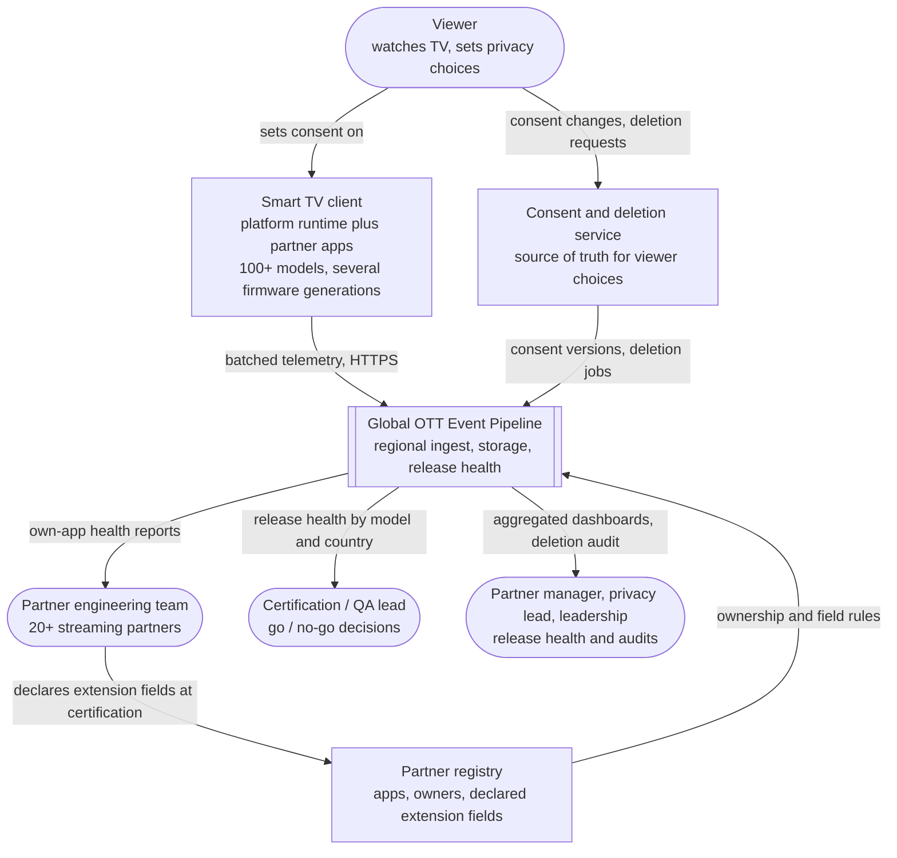
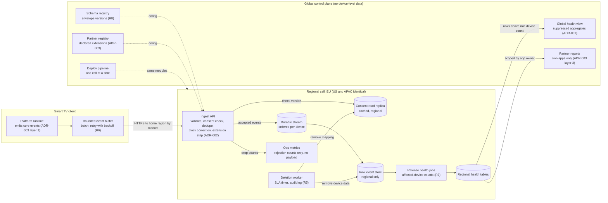
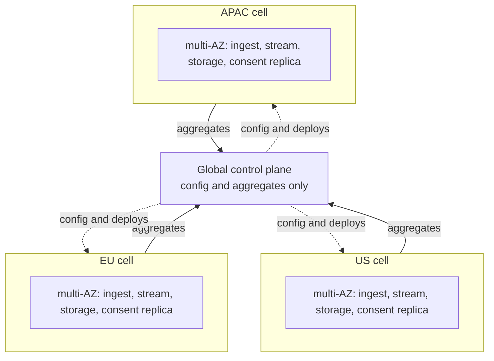

# Architecture Overview

How the pieces fit together. The *why* behind each piece lives in the ADRs; this page is the map.

- [ADR-001](03-decision-records/ADR-001-multi-region-strategy.md): regional cells with an aggregate-only global view
- [ADR-002](03-decision-records/ADR-002-event-ingest-pattern.md): consent-enforcing regional ingest
- [ADR-003](03-decision-records/ADR-003-partner-integration-pattern.md): platform-first partner integration with declared extensions

Diagrams use [C4](https://c4model.com/) levels and are written in Mermaid so they render on GitHub and stay diffable.

## System context (C4 level 1)

Who uses the pipeline, and what it talks to.

## Containers (C4 level 2)

One regional cell in detail, plus the thin global control plane. The EU, US, and APAC cells are identical in shape (ADR-001).

## Deployment view

Where the cells sit, and the only path data takes between them.

There is deliberately no arrow between cells. Raw events never cross regions, and there is no cross-region failover (ADR-001, rule 3).

## Request path, end to end

1. The platform runtime records a core event and adds it to a bounded buffer. When a batch is ready, the client posts it to its **home region**, which is chosen by registered market.
2. The ingest API runs batch-level gates in order: envelope schema, no real identifiers, pseudonymous device ID, correct region, and consent version. Any failure drops the whole batch and records a count by reason.
3. Each event is then validated on its own. Invalid events are dropped and counted; the rest of the batch continues. Duplicates are skipped by `event_id`. Partner extensions are checked against the registry and stripped if invalid, without affecting the core event. Timestamps are corrected from the batch's send time.
4. Accepted events go to the regional stream and raw store. Release-health jobs compute affected-device counts per partner, app version, model, firmware, and country.
5. Suppressed aggregates flow to the global view and to scoped partner reports. Deletion requests remove the consent mapping and the device's data from its home cell, with an audit entry.

## Requirement coverage

| Req | Where it is handled | Reference implementation |
|---|---|---|
| R1 device context | Envelope core, ingest validation | `src/ott_ingest/schema.py` |
| R2 platform event set | Platform runtime, core event types | `schema.CORE_EVENT_TYPES` |
| R3 consent at ingest | Ingest plus consent read replica | `consent.py`, `ingest.py` |
| R4 residency | Regional cells, market routing, aggregate-only export | `routing.py`, `health.export_aggregates` |
| R5 deletion SLA | Deletion worker, audit log | `deletion.py`, `stream.py` |
| R6 unreliable clients | Client buffer, dedupe, clock correction | `client.py`, `delivery.py` |
| R7 release health | Health jobs, global view, partner reports | `health.py` |
| R8 schema versions | Schema registry, multi-version parsing | `schema.py` |

## Status

| Piece | State |
|---|---|
| Problem space, ADR-001 to ADR-003, this overview, rollout plan | Written |
| Ingest reference implementation and tests (`src/`, `tests/`) | Working, development-scale |
| Deletion, release health, client buffer (as library code) | Working, development-scale |
| HTTP service wrapper, authentication, real stream and storage | Not built; out of scope for the reference |
| Terraform modules (`infrastructure/`) | Planned |
